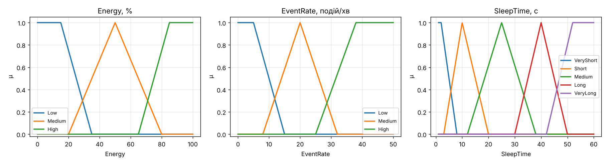
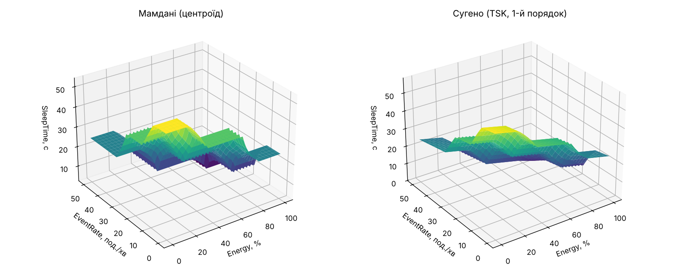
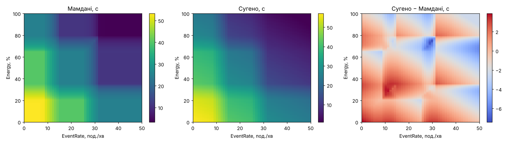
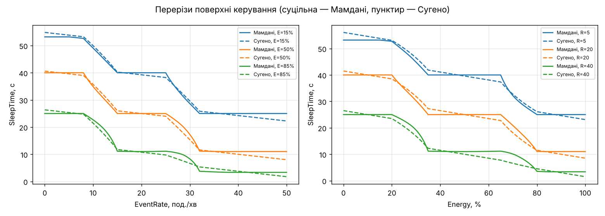
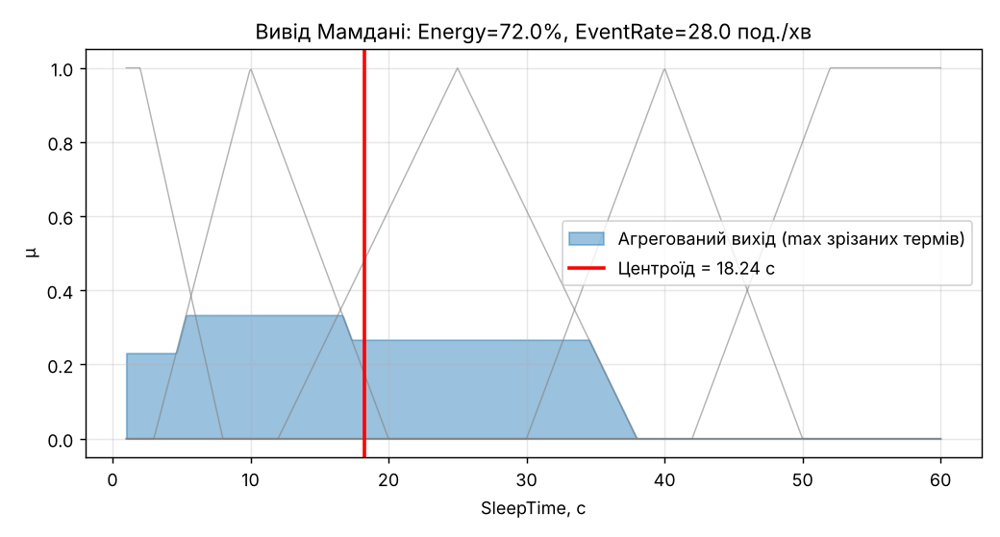
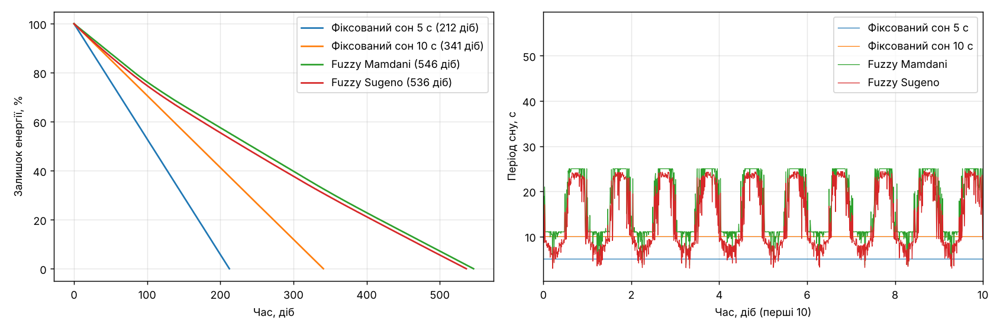

# Звіт з лабораторної роботи №3
**Тема:** Нечітка логіка, нечіткий вивід та проєкти нечітких контролерів у комп'ютерній інженерії (Python 3.10+)

**Варіант 13 (CE):** Нечіткий контролер енергозбереження вузла WSN сенсора

**Виконав:** Черемис Ростислав, група М-26

## 1. Мета
Змоделювати нечіткі множини та лінгвістичні змінні, реалізувати нечіткий вивід **Мамдані** (min–max–centroid) і **Такагі-Сугено** (1-й порядок), побудувати нечіткий контролер періоду сну мікроконтролера бездротового датчика та порівняти алгоритми за результатом, гладкістю керування та обчислювальними витратами.

## 2. Постановка задачі
| Параметр | Значення |
|---|---|
| Вхід 1 | `Energy` — залишок енергії акумулятора, 0..100 % |
| Вхід 2 | `EventRate` — інтенсивність подій, 0..50 подій/хв |
| Вихід | `SleepTime` — період сну мікроконтролера, 1..60 с |
| Алгоритми | Mamdani vs Sugeno (TSK) |
| Метрики | чіткий вихід, кількість активних правил, час виводу (`perf_counter`), пікова пам'ять (`tracemalloc`) |
| Інженерна мета | продовжити термін автономної роботи датчика у 2–3 рази |

Логіка керування: чим менше енергії — тим довше сон (економія); чим більше подій — тим коротше сон (щоб не втрачати оперативність). При низькому заряді та багатьох подіях контролер шукає компроміс.

## 3. Реалізація контролера
**Лінгвістичні змінні** (параметри у `config/rules_config.yaml`):

| Змінна | Терми та ФН |
|---|---|
| Energy | Low — трапеція (0, 0, 15, 35); Medium — трикутник (20, 50, 80); High — трапеція (65, 85, 100, 100) |
| EventRate | Low — трапеція (0, 0, 5, 15); Medium — трикутник (8, 20, 32); High — трапеція (25, 38, 50, 50) |
| SleepTime | VeryShort — трапеція (1, 1, 2, 8); Short — трикутник (3, 10, 20); Medium — (12, 25, 38); Long — (30, 40, 50); VeryLong — трапеція (42, 52, 60, 60) |

**База правил** (9 правил, `IF Energy is … AND EventRate is … THEN SleepTime is …`):

| Energy \ EventRate | Low | Medium | High |
|---|---|---|---|
| **Low** | VeryLong | Long | Medium |
| **Medium** | Long | Medium | Short |
| **High** | Medium | Short | VeryShort |

**Мамдані:** фазифікація → агрегування умов `min` → імплікація (зрізання терму виходу) `min` → акумуляція `max` → дефазифікація центром ваги на сітці з 601 точки.

**Сугено (1-й порядок):** для кожного правила `y_i = −0.15·Energy − 0.20·EventRate + c_i` (коефіцієнти `c_i` задані в YAML і підібрані так, щоб у центрі правила значення збігалося з центром відповідного терму Мамдані); агрегування умов `prod`; вихід `y* = Σ w_i·y_i / Σ w_i`, обмежений діапазоном [1, 60] с.

## 4. Структура проєкту
```
lab3_fuzzy_python/
├── config/rules_config.yaml     # терми, параметри ФН, база правил, коефіцієнти Сугено
├── src/
│   ├── __init__.py
│   ├── fuzzy_mf.py              # TriangularMF, TrapezoidalMF
│   ├── fuzzy_set.py             # FuzzySet, LinguisticVariable
│   ├── fuzzy_rules.py           # Rule, RuleBase, перевірка повноти/суперечності, завантаження YAML
│   ├── fuzzy_engine.py          # MamdaniEngine, SugenoEngine
│   ├── simulation.py            # модель ресурсу батареї вузла
│   └── plots.py                 # графіки
├── reports/                     # графіки та CSV
├── main.py
├── requirements.txt
└── README.md
```
Запуск: `pip install -r requirements.txt && python main.py` (≈20 с, основний час — симуляція батареї).

## 5. Результати
Тест-кейси (час — медіана 300 викликів, пам'ять — пік `tracemalloc` одного виклику):

| Кейс (Energy %, EventRate) | Алгоритм | SleepTime (с) | Активні правила | Час виводу (мс) | Пам'ять (КБ) |
|---|---|---|---|---|---|
| Повна батарея, багато подій (90; 40) | Mamdani | 3.35 | 1 | 0.0623 | 10.4 |
| | Sugeno (TSK) | 3.00 | 1 | 0.0606 | 1.8 |
| Низький заряд, спокій (15; 3) | Mamdani | 53.21 | 1 | 0.0628 | 10.4 |
| | Sugeno (TSK) | 54.25 | 1 | 0.0611 | 1.8 |
| Середній стан (60; 12) | Mamdani | 30.88 | 2 | 0.0645 | 10.4 |
| | Sugeno (TSK) | 30.59 | 2 | 0.0618 | 1.8 |
| Перехідна зона (72; 28) | Mamdani | 18.24 | 4 | 0.0672 | 10.4 |
| | Sugeno (TSK) | 12.35 | 4 | 0.0621 | 1.8 |
| Конфлікт: низький заряд, багато подій (20; 30) | Mamdani | 28.64 | 2 | 0.0635 | 10.4 |
| | Sugeno (TSK) | 28.83 | 2 | 0.0616 | 1.8 |

Час і пам'ять залежать від машини й можуть відрізнятися між запусками; значення виходу відтворюються (алгоритм детермінований).

**Порівняння поверхонь керування** (сітка 101×51):

| Показник | Mamdani | Sugeno |
|---|---|---|
| Діапазон SleepTime, с | 3.35 … 53.21 | 1.00 … 57.10 |
| Середній / максимальний \|grad\|, с на одиницю входу | 0.707 / 4.354 | 0.729 / 2.306 |
| Частка «плоских» кроків (вихід не змінюється) | 51.8 % | 0.7 % |
| Максимальне зростання виходу при збільшенні входу (немонотонність), с | 0.19 | 0.00 |
| Середній час виводу, мс/виклик | 0.0732 | 0.0741 |
| З них спільна фазифікація, мс | 0.0486 | 0.0486 |

Розбіжність між алгоритмами: MAE = 1.60 с, RMSE = 1.98 с, максимум 7.42 с (у перехідних зонах перекриття термів). Кількість активних правил у всій області входів — від 1 до 4 (1 правило — 2847 точок сітки, 2 — 1968, 4 — 336, жодної точки без правил немає).

**Симуляція ресурсу батареї** (ілюстративна модель вузла: батарея 1000 мА·год, 15 мА на пробудження 0.05 с, 10 мкА у сні, 0.01 с обробки події; добовий профіль подій 15 ± 12 подій/хв із шумом; затримка події — в середньому половина періоду сну):

| Режим | Ресурс (діб) | Відносно 5 с | Середній період (с) | Середня затримка події (с) |
|---|---|---|---|---|
| Фіксований сон 5 с | 212 | ×1.00 | 5.0 | 2.5 |
| Фіксований сон 10 с | 341 | ×1.61 | 10.0 | 5.0 |
| Fuzzy Mamdani | 546 | ×2.57 | 31.7 | 13.8 |
| Fuzzy Sugeno | 536 | ×2.53 | 31.9 | 13.7 |

### Графіки
- `reports/membership_functions.png` — функції належності входів і виходу
- `reports/control_surface.png` — 3D-поверхні керування Мамдані та Сугено
- `reports/surface_difference.png` — теплові карти обох поверхонь та їхня різниця
- `reports/cross_sections.png` — перерізи поверхні (SleepTime від EventRate та від Energy)
- `reports/mamdani_inference.png` — агрегований вихід і центроїд для кейсу (72; 28)
- `reports/battery_simulation.png` — розряд батареї та період сну в часі








## 6. Аналіз
1. **Вибір функцій належності.** Крайні терми (`Low`, `High`, `VeryShort`, `VeryLong`) задано трапеціями з «плечима» (a = b або c = d): на межах діапазону (0 % енергії, 50 подій/хв) належність лишається 1, а не падає до 0. Проміжні терми — трикутники з одним піком. Сусідні терми перетинаються (точка перетину входу Energy Low/Medium — 29 % при μ = 0.3), тому мінімум max-належності по кожній змінній додатний (0.30 для Energy, 0.28 для EventRate, 0.35 для SleepTime): жоден вхід не лишається «непокритим». Кускові лінійні ФН потребують лише додавання, множення та порівняння, що важливо для мікроконтролера; 5 термів виходу дають достатню роздільну здатність (від 3 до 53 с).
2. **Повнота та несуперечливість бази правил.** Усі 3 × 3 = 9 комбінацій термів входів мають правило (перевірка `check_completeness`), правил з однаковою умовою й різними висновками немає (`check_consistency`). На сітці 101×51 завжди спрацьовує 1–4 правила, випадків без жодного правила немає. Монотонність: Сугено строго не зростає за обома входами; Мамдані має малі локальні відхилення до 0.19 с (≈0.3 % діапазону), що пов'язано з різною шириною термів при центроїдній дефазифікації, — для керування сном практично несуттєво, але це не ідеальна монотонність.
3. **Гладкість керування та обчислювальна складність.** Мамдані з `min`-імплікацією дає «сходинки»: 51.8 % кроків сітки — плато, де вихід не реагує на зміну входу (мертві зони, коли переважає один терм), і крутіші переходи між ними (максимальний градієнт 4.35 проти 2.31 у Сугено). Сугено через лінійні висновки реагує майже на кожну зміну входу (0.7 % плоских кроків) і гладше, однак лінійна екстраполяція виводить результат за межі центрів термів (1.00…57.10 с проти 3.35…53.21 с), тому потрібне обмеження діапазону; найбільша розбіжність алгоритмів (до 7.4 с) — у зонах перекриття. За пам'яттю Сугено помітно легший: 1.8 КБ проти 10.4 КБ (Мамдані зберігає масиви на 601 точку). За часом у цій Python-реалізації різниці практично немає (0.073 проти 0.074 мс): майже дві третини часу займає спільна фазифікація (0.049 мс), а специфічні частини вимірюються сотими частками мілісекунди. Теоретично Мамдані дорожчий (центроїд — O(N·правил) проти O(правил)), але це виміряно не було і на мікроконтролері може проявитися сильніше.
4. **Придатність для реального часу.** ≈ 0.07 мс на виклик (≈ 13 тис. виводів/с на ПК, на якому проводились виміри) при тому, що рішення про період сну приймається раз на цикл пробудження (секунди й довше): навантаження на порядки менше за бюджет. Для безпосереднього запуску на МК з обмеженою пам'яттю краще Сугено або попередньо обчислена таблиця поверхні керування (LUT) з інтерполяцією; вимірювання на самому мікроконтролері в роботі не виконувались.
5. **Досягнення інженерної мети.** У моделі вузла нечіткий контролер подовжує ресурс батареї у ×2.5–2.6 порівняно з фіксованим сном 5 с, тобто в заданих межах «у 2–3 рази». Ціна — більша затримка реакції на події (в середньому 13.8 с проти 2.5 с): фіксований сон 10 с дає ×1.61 при затримці 5 с. Нечіткий контролер адаптується — скорочує сон при багатьох подіях і високому заряді, подовжує при низькому заряді та спокої.
6. **Обмеження.** Енергетична модель вузла спрощена й ілюстративна (параметри струмів, профіль подій і припущення, що події накопичуються між пробудженнями, задані мною); абсолютні числа ресурсу залежать від цих припущень і від вибору базового режиму 5 с, тому вони не є вимірюванням реального пристрою. Для реального вузла параметри слід замінити виміряними, а ФН та коефіцієнти Сугено — налаштувати на реальних даних.

## 7. Висновки
Реалізовано модульний Python-проєкт нечіткого контролера (ФН, лінгвістичні змінні, база правил із YAML, двигуни Мамдані та Сугено) для варіанта 13. База з 9 правил повна та несуперечлива. Обидва алгоритми дають близькі результати (середня розбіжність 1.6 с із 59), Сугено гладше реагує на входи та вимагає менше пам'яті, Мамдані дає інтерпретовані плато й обмежений діапазон виходу; за часом у Python вони еквівалентні, а ≈ 0.07 мс на вивід цілком достатньо для реального часу. У модельному сценарії контролер подовжує ресурс батареї у ≈ 2.5 раза порівняно з фіксованим сном 5 с ціною більшої затримки реакції.
